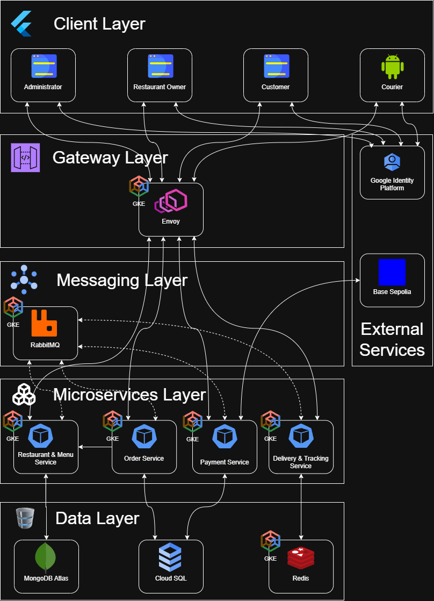

# Cloud-Native Food Delivery Platform

Prototype developed for the MSc dissertation:

> **Design and Implementation of a Cloud-Native Microservices-Based Food Delivery Platform with Blockchain Payment Integration**

The platform combines cloud-native microservices for food-delivery operations with a Solidity-based blockchain escrow and multi-party settlement mechanism.

This repository contains an academic prototype. It uses test-network cryptocurrency only and does not provide production cryptocurrency custody or process real financial transactions.

---

## Project Status

Development follows **Personal Kanban** using iterative, incremental vertical slices.

**Cycle 2 — Restaurant and Order Workflow is complete.**

The platform currently implements:

- a modular monorepo;
- four independently deployable backend services;
- Flutter web and Android clients;
- shared Protobuf contracts;
- Envoy as the centralized edge gateway;
- local Docker Compose infrastructure;
- service health/readiness endpoints;
- Google Cloud Identity Platform authentication;
- trusted role claims for `CUSTOMER`, `RESTAURANT_OWNER`, `COURIER`, and `ADMIN`;
- JWT validation and role-based access control at Envoy;
- service-level authorization guards;
- authenticated Flutter login/logout and role-based routing;
- request-ID propagation from Envoy to backend services;
- restaurant and menu management for restaurant owners;
- customer restaurant and menu browsing;
- basket and checkout;
- server-authoritative order pricing;
- PostgreSQL-backed order persistence;
- customer order history and details;
- restaurant-owner order processing;
- `PLACED -> ACCEPTED` and `PLACED -> REJECTED` workflows;
- automated contract, backend, Flutter, and infrastructure validation;
- CI/CD workflows;
- container-image publication and release versioning.

Later cycles add RabbitMQ-based workflows, blockchain payments, delivery and real-time tracking, cloud deployment, and evaluation.

Firebase Cloud Messaging is not part of the prototype implementation scope and is retained as potential future work.

---

## Architecture

The backend consists of four business microservices:

| Service | Implementation | Data store |
|---|---|---|
| Restaurant and Menu Service | Java 25 + Spring Boot | MongoDB |
| Order Service | Java 25 + Spring Boot | PostgreSQL |
| Delivery and Tracking Service | Go | Redis |
| Payment Service | Go | PostgreSQL |

Supporting platform components include:

- **Google Cloud Identity Platform** for authentication and identity management;
- **Envoy Proxy** as the centralized edge gateway;
- **RabbitMQ** for asynchronous communication and Saga choreography;
- **Base Sepolia** for test-network smart-contract execution.



[View the high-resolution architecture PDF](docs/diagrams/platform-architecture.pdf)

The editable source is available at

[`docs/diagrams/platform-architecture.drawio`](docs/diagrams/platform-architecture.drawio).

Each service exclusively owns its datastore. Cross-service database access is prohibited.

RabbitMQ communicates only with application services and does not connect directly to databases.

The architecture diagram represents the target prototype architecture. RabbitMQ-based workflows, blockchain settlement, courier delivery, live tracking, WebSockets, and GKE deployment are implemented in later development cycles.

---

## Technology Stack

The stack contains both technologies already implemented in Cycles 1–2 and technologies planned for later cycles.

| Area | Technology |
|---|---|
| Frontend | Flutter / Dart |
| Customer | Flutter Web |
| Restaurant Owner | Flutter Web |
| Administrator | Flutter Web |
| Courier | Flutter Android |
| Edge gateway | Envoy Proxy |
| Authentication / CIAM | Google Cloud Identity Platform / Firebase Auth SDK |
| Authentication tokens | Identity Platform ID tokens (JWT) |
| Edge authorization | Envoy JWT authentication and RBAC |
| Service authorization | Trusted identity metadata and role guards |
| Java services | Java 25 / Spring Boot |
| Go services | Go 1.26.6 |
| Internal synchronous communication | gRPC |
| Web client communication | REST through Envoy |
| Courier location ingestion | Native gRPC streaming |
| Customer live tracking | WebSockets |
| Messaging | RabbitMQ / AMQP 0-9-1 |
| Relational storage | PostgreSQL / Cloud SQL |
| Document storage | MongoDB Atlas |
| Tracking storage | Redis |
| Java containerisation | Jib |
| Go containerisation | `ko` |
| Local orchestration | Docker Compose |
| Cloud orchestration | Google Kubernetes Engine |
| Smart contract | Solidity |
| Smart-contract tooling | Foundry |
| Test blockchain | Base Sepolia |

FCM push notifications are reserved for possible future work rather than the prototype implementation.

---

## Repository Structure

```text
food-delivery-platform/
├── .github/
│   ├── workflows/
│   │   ├── ci.yml
│   │   ├── cd.yml
│   │   └── release.yml
│   ├── dependabot.yml
│   └── pull_request_template.md
│
├── apps/
│   ├── platform_web/
│   ├── courier_mobile/
│   └── packages/
│       ├── shared_auth/
│       ├── shared_models/
│       └── shared_networking/
│
├── services/
│   ├── restaurant-menu-service/
│   ├── order-service/
│   ├── delivery-tracking-service/
│   └── payment-service/
│
├── contracts/
│   ├── proto/
│   ├── events/
│   ├── websocket/
│   └── blockchain/
│
├── gateway/
│   └── envoy/
│
├── infrastructure/
│
├── smart-contracts/
│   └── escrow/
│
├── tools/
│   └── identity-admin/
│
├── docs/
│   ├── cycles/
│   │   ├── cycle-1/
│   │   └── cycle-2/
│   ├── decisions/
│   ├── diagrams/
│   └── risk-register.md
│
├── scripts/
├── compose.yaml
├── go.work
├── pubspec.yaml
└── README.md
```

The repository is a **modular monorepo**. Each microservice remains independently buildable, testable, containerised, and deployable.

---

## Communication Model

Web clients use REST/JSON endpoints exposed by Envoy, which translates selected operations into backend gRPC calls through gRPC-JSON transcoding using the shared Protobuf contracts.

```text
Flutter Web
    → REST/JSON
    → Envoy (gRPC-JSON transcoder)
    → gRPC backend services
```

Internal synchronous service communication uses gRPC where required.

Cycle 2 includes synchronous order quotation:

```text
Order Service
    → gRPC
    → Restaurant and Menu Service
```

This allows menu availability and pricing to be validated by the service that owns that data rather than trusting client-supplied prices.

Courier location updates are planned to use native gRPC streaming:

```text
Courier Mobile
    → gRPC
    → Envoy
    → Delivery and Tracking Service
```

Customer live tracking is planned to use:

```text
Delivery and Tracking Service
    → Envoy
    → WebSocket
    → Customer Web
```

Customer WebSocket connections will require a browser-compatible authentication mechanism consistent with Identity Platform. The Delivery and Tracking Service must also authorize access to the specific delivery being tracked, rather than relying on the `CUSTOMER` role alone.

Distributed workflows will use RabbitMQ events and choreography-based Sagas.

Individual GPS location updates will not be sent through RabbitMQ.

---

## Authentication and Authorization

Google Cloud Identity Platform authenticates users. Flutter clients use Firebase Auth SDKs to obtain Identity Platform ID tokens.

The platform defines four roles:

```text
CUSTOMER
RESTAURANT_OWNER
COURIER
ADMIN
```

Roles are stored as trusted custom claims and are assigned only through privileged administrative tooling. Clients do not create or select their own roles.

Protected requests follow this flow:

```text
Flutter Client
    ↓
Identity Platform ID Token
    ↓
Authorization: Bearer <token>
    ↓
Envoy JWT validation
    ↓
Envoy RBAC
    ↓
trusted identity metadata
    ↓
backend authorization guard
```

Envoy validates the token signature, issuer, audience, and validity before forwarding protected requests.

Verified identity information is propagated internally using:

```text
x-authenticated-sub
x-authenticated-role
```

Backend services retain a second authorization boundary and reject requests with missing or incorrect trusted identity metadata.

Envoy must remove or overwrite client-supplied identity headers. Direct service-to-service gRPC calls bypass the public gateway and require a separately controlled trust boundary; backend services must not treat arbitrary caller-supplied identity metadata as verified.

Public health routes do not require authentication.

### Access Matrix

Expected HTTP responses for the Cycle 1 protected role-probe endpoints:

| Token | Customer | Restaurant | Courier | Admin |
|---|---:|---:|---:|---:|
| None | 401 | 401 | 401 | 401 |
| Invalid | 401 | 401 | 401 | 401 |
| CUSTOMER | 200 | 403 | 403 | 403 |
| RESTAURANT_OWNER | 403 | 200 | 403 | 403 |
| COURIER | 403 | 403 | 200 | 403 |
| ADMIN | 403 | 403 | 403 | 200 |

The complete access-control matrix was verified during Cycle 1 acceptance testing and retained as a regression baseline.

---

## Request Correlation

Envoy assigns or propagates an `x-request-id` for incoming requests.

The identifier is forwarded to backend services and included in structured application logs.

Example flow:

```text
Client
    ↓
Envoy
requestId = <uuid>
    ↓
gRPC
    ↓
Backend Service
requestId = <same uuid>
```

This allows a request to be traced across the gateway and service boundary.

---

## Data Ownership

The Order and Payment services share the same PostgreSQL server locally and the same Cloud SQL instance in the target deployment, but use separate logical databases and credentials.

```text
Order Service
    → order_service_db
    → order_service_user
Payment Service
    → payment_service_db
    → payment_service_user
```

Neither service may access the other's database.

The Restaurant and Menu Service owns its MongoDB data.

The Delivery and Tracking Service owns Redis tracking state.

---

## Containerisation

No Dockerfiles are maintained for the four application microservices.

### Java

The Spring Boot services use Jib:

```text
Java source
    → Maven
    → Jib
    → OCI image
```

### Go

The Go services use `ko`:

```text
Go source
    → ko
    → OCI image
```

The local build script builds all four service images:

```bash
./scripts/build-local-images.sh
```

Local image names are:

```text
food-delivery/restaurant-menu-service:local
food-delivery/order-service:local
food-delivery/delivery-tracking-service:local
food-delivery/payment-service:local
```

The `local` tag is used only for local development.

---

## Prerequisites

Install:

- Git;
- Docker Desktop with Docker Compose;
- Java 25;
- Go 1.26.6;
- Flutter;
- Dart;
- Buf.

Verify:

```bash
git --version
docker --version
docker compose version
java -version
go version
flutter --version
dart --version
buf --version
```

On Windows, repository `.sh` files should use **LF** line endings and are best executed through Git Bash.

---

## Initial Setup

Clone the repository:

```bash
git clone https://github.com/YOUR_USERNAME/food-delivery-platform.git
cd food-delivery-platform
```

Create local environment configuration:

```bash
cp .env.example .env
```

PowerShell:

```powershell
Copy-Item .env.example .env
```

Resolve Flutter workspace dependencies:

```bash
flutter pub get
dart pub workspace list
```

Synchronise the Go workspace:

```bash
go work sync
```

---

## Local Docker Compose Environment

Validate the Compose configuration:

```bash
docker compose config --quiet
```

Start the platform:

```bash
docker compose up -d
```

Inspect it:

```bash
docker compose ps
```

Stop it:

```bash
docker compose down
```

Remove persistent local volumes only when intentionally resetting the environment:

```bash
docker compose down -v
```

### Startup Dependencies

```text
Restaurant and Menu → MongoDB + RabbitMQ
Order               → PostgreSQL + RabbitMQ
Delivery            → Redis + RabbitMQ
Payment             → PostgreSQL + RabbitMQ
```

Infrastructure dependencies use Compose health checks. RabbitMQ is provisioned locally, while business-event processing and Saga choreography will be implemented in later development cycles.

Envoy starts after the application containers are available.

---

## Local Network Exposure

Only selected services are published to the host.

| Port | Purpose |
|---|---|
| `8080` | Envoy public development listener |
| `18081` | Alternate Envoy host port used by the Android emulator |
| `9901` | Envoy administration interface |
| `15672` | RabbitMQ management interface |

Backend services and databases remain private to the Docker network.

Examples of internal Compose DNS names:

```text
order-service:8080
payment-service:8080
postgres:5432
mongodb:27017
redis:6379
rabbitmq:5672
```

The Envoy administration interface is intended for local inspection only.

---

## Health Endpoints

Public health routes are exposed through Envoy:

| Endpoint | Target |
|---|---|
| `/health` | Envoy |
| `/health/restaurant` | Restaurant and Menu Service |
| `/health/order` | Order Service |
| `/health/delivery` | Delivery and Tracking Service |
| `/health/payment` | Payment Service |

PowerShell smoke test:

```powershell
curl.exe -fsS http://localhost:8080/health
curl.exe -fsS http://localhost:8080/health/restaurant
curl.exe -fsS http://localhost:8080/health/order
curl.exe -fsS http://localhost:8080/health/delivery
curl.exe -fsS http://localhost:8080/health/payment
```

The root URL currently returns `404` by design because no root route is configured.

---

## Running the Flutter Clients

### Web Platform

```powershell
cd apps/platform_web
flutter run -d chrome `
  --web-port 3000 `
  --dart-define=API_BASE_URL=http://localhost:8080
```

The web application supports:

- `CUSTOMER` — restaurant browsing, checkout, and order history;
- `RESTAURANT_OWNER` — restaurant/menu management and order processing;
- `ADMIN` — authenticated foundation dashboard and protected endpoint probe.

The full Administrator interface is deferred to a later development cycle.

### Courier Android App

Check the available emulator:

```powershell
flutter devices
```

Run the courier application:

```powershell
cd apps/courier_mobile
flutter run `
  -d emulator-5554 `
  --dart-define=API_BASE_URL=http://10.0.2.2:18081
```

The emulator identifier may differ.

The Android emulator uses `10.0.2.2` to reach the host machine.

The courier application accepts only users whose trusted role claim is:

```text
COURIER
```

Delivery functionality is implemented in a later development cycle.

---

## Local Verification

### Java

```bash
cd services/restaurant-menu-service
./mvnw -B -ntp verify
cd ../..
cd services/order-service
./mvnw -B -ntp verify
cd ../..
```

### Go

```bash
go vet ./services/delivery-tracking-service/...
go test ./services/delivery-tracking-service/...
go vet ./services/payment-service/...
go test ./services/payment-service/...
```

If Windows Application Control blocks generated Go test executables, run the checks inside the matching Go container.

Example:

```powershell
docker run --rm `
  -v "${PWD}:/workspace" `
  -w /workspace `
  golang:1.26.6 `
  sh -c "go vet ./services/delivery-tracking-service/... && go test ./services/delivery-tracking-service/..."
```

### Flutter

Relevant workspace members are:

```text
apps/platform_web
apps/courier_mobile
apps/packages/shared_auth
apps/packages/shared_models
apps/packages/shared_networking
```

For each relevant package:

```bash
flutter analyze
flutter test
```

Packages without a `test/` directory are analyzed but do not require `flutter test`.

Build the web application:

```bash
cd apps/platform_web
flutter build web --release
cd ../..
```

### Protobuf

```bash
cd contracts/proto
buf format --diff --exit-code
buf lint
buf build
buf generate
buf build \\
  --as-file-descriptor-set \\
  --exclude-source-info \\
  -o ../../gateway/envoy/foundation-descriptor.pb
cd ../..
```

Generated source code and the Envoy descriptor are checked for drift in CI.

### Infrastructure

```bash
docker compose config --quiet
bash -n infrastructure/postgres/init/create-service-databases.sh
```

Validate Envoy through Compose:

```powershell
docker compose run --rm --no-deps envoy `
  --mode validate `
  -c /etc/envoy/envoy.yaml
```

---

## CI/CD

The repository contains three GitHub Actions workflows:

| Workflow | Trigger | Responsibility |
|---|---|---|
| `ci.yml` | Pull request targeting `main` | Validation and testing |
| `cd.yml` | Push / merge to `main` | Publish SHA-tagged continuous images |
| `release.yml` | Git tag `vX.Y.Z` | Promote an existing build to a formal release |

### Continuous Integration

CI validates:

- Protobuf contracts and generated-artifact drift;
- Java builds, tests, and Jib image construction;
- Go formatting, vetting, compilation, tests, and `ko` image construction;
- Flutter formatting, analysis, tests, and web build;
- Docker Compose configuration;
- PostgreSQL initialization-script syntax;
- Envoy configuration.

The aggregate required check is:

```text
CI / Required
```

### Continuous Delivery

After a successful PR is merged, `cd.yml` publishes all four application images using the complete Git commit SHA:

```text
restaurant-menu-service:sha-<git-sha>
order-service:sha-<git-sha>
delivery-tracking-service:sha-<git-sha>
payment-service:sha-<git-sha>
```

These are continuous builds rather than formal releases.

---

## Versioning and Releases

The repository uses one **platform-level Semantic Version** rather than independent service versions.

Planned milestone progression:

```text
v0.1.0  Foundation and Access Control
v0.2.0  Restaurant and Order Workflow
v0.3.0  Messaging and Blockchain Payment
v0.4.0  Delivery and Real-Time Tracking
v0.5.0  Hardening, Deployment and Evaluation
v1.0.0  Final evaluated prototype
```

Versions are created when milestones are complete and merged into `main`.

Annotated Git tags are the release source of truth:

```bash
git tag -a v0.1.0 -m "Food Delivery Platform v0.1.0"
git push origin v0.1.0
```

The release workflow promotes the already-published SHA image rather than rebuilding it.

```text
:sha-<git-sha>
      |
      +---- :0.1.0
      |
      +---- :latest
```

`latest` means the latest formal release.

---

## Git Workflow

Development uses short-lived branches:

```text
feature/<name>
fix/<name>
chore/<name>
docs/<name>
test/<name>
```

Normal flow:

```text
main
 ↓
feature branch
 ↓
Pull Request
 ↓
Full CI
 ↓
CI / Required
 ↓
Merge commit
 ↓
main
 ↓
SHA-tagged image publication
```

The repository uses merge commits rather than squash or rebase merging.

Because this is a solo-developed dissertation project, mandatory external approvals and merge queues are not required.

Commit messages follow a Conventional Commit-style convention:

```text
feat(auth): integrate Identity Platform
fix(gateway): correct service routing
test(auth): expand access-control coverage
ci: verify generated contract artifacts
docs: update architecture documentation
```

---

## Dependency Management

Dependabot checks:

```text
GitHub Actions
Maven
Go modules
Flutter / Dart
```

Dependabot pull requests pass through the same `CI / Required` quality gate.

---

## Security

Never commit:

```text
.env
service-account credentials
JWTs
Docker Hub tokens
database passwords
blockchain private keys
wallet seed phrases
Firebase Admin credentials
production credentials
```

Only test accounts, test funds, and test-network blockchain assets are used in the prototype.

Authentication roles are assigned only through privileged administrative tooling.

The application clients must never be trusted to assign privileged roles themselves.

Order ownership and restaurant ownership are derived from trusted authenticated identity rather than client-supplied identity values.

Authoritative menu availability and pricing are obtained from the Restaurant and Menu Service rather than trusted from the customer client.

---

## Development Evidence

Development evidence is retained under `docs/cycles/`.

- [Cycle 1 — Foundation and Access Control](docs/cycles/cycle-1/description.md)
- [Cycle 2 — Restaurant and Order Workflow](docs/cycles/cycle-2/description.md)

The current architecture files are stored under [`docs/diagrams/`](docs/diagrams/).

---

## Development Methodology

Development follows **Personal Kanban** using continuous flow:

```text
Backlog
   ↓
Ready
   ↓
In Progress
   ↓
Review
   ↓
Done
```

Blocked work is tracked separately.

The project uses:

- vertical-slice development;
- continuous testing and integration;
- MoSCoW prioritisation;
- a work-in-progress limit of one primary implementation task;
- risk review throughout development.

Development cycles represent logical functional increments rather than time-boxed Scrum sprints.

Architecture decisions, risk records, diagrams, and development evidence are stored under `docs/`.

---

## Planned Development and Future Work

### Remaining Prototype Development

Functionality planned for subsequent development cycles includes:

- RabbitMQ-based event-driven Saga workflows;
- Solidity escrow and multi-party settlement;
- Base Sepolia integration;
- payment failure and settlement-pending handling;
- extended Administrator payment and settlement views;
- courier assignment and delivery workflow;
- Redis-backed live location tracking;
- customer WebSocket tracking;
- GKE deployment and evaluation.

### Potential Future Enhancements

The following improvements are outside the current prototype implementation scope:

- **Firebase Cloud Messaging (FCM)** — introduce optional push notifications for delivery milestones when customers are not actively connected to live tracking.
- **Transactional Outbox** — improve critical Saga event publication by atomically recording business-state changes and outgoing events in the Order and Payment services' own PostgreSQL databases, addressing the accepted dual-write failure window.
- **iOS Courier Application** — extend the Flutter mobile client to iOS, incorporating platform-specific location permissions, background-execution handling, application signing and provisioning, and device testing to support reliable courier tracking on Apple devices.

---

## Licence

This repository currently contains an academic dissertation prototype.

No open-source licence has been selected.
