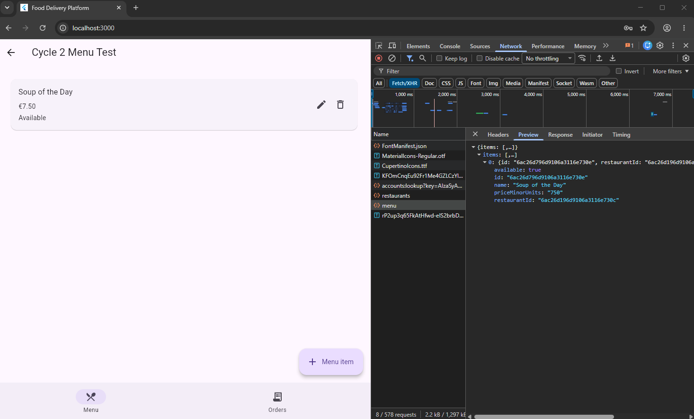
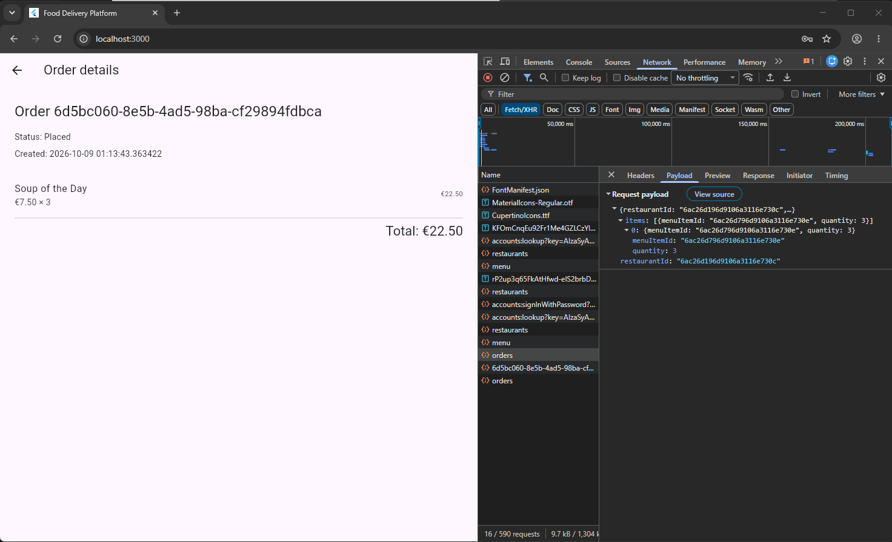
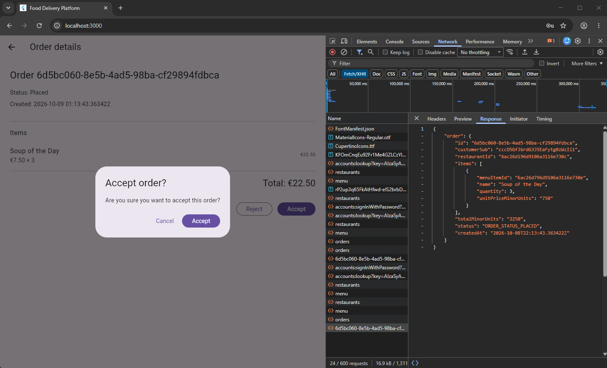
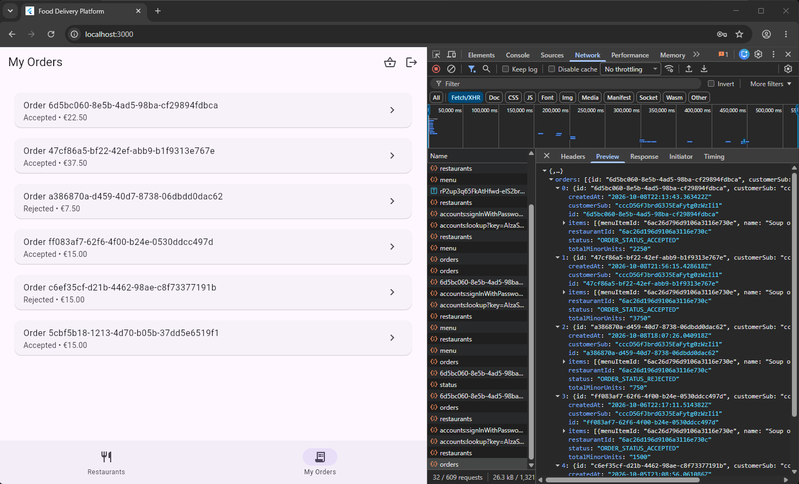
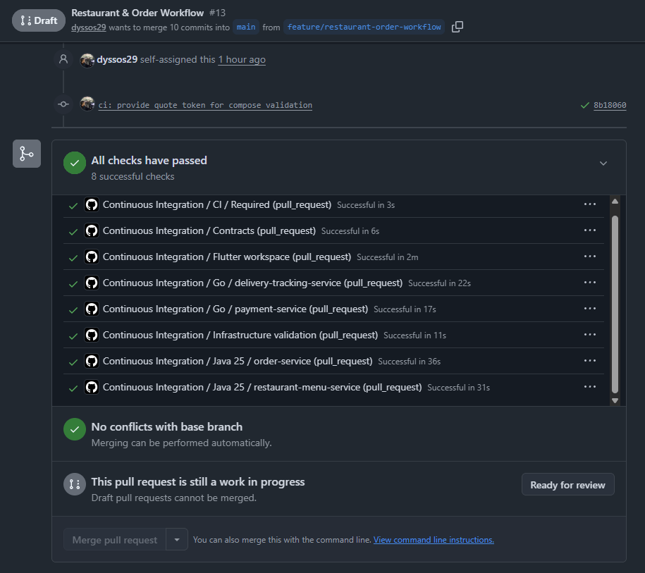

# Cycle 2 — Restaurant and Order Workflow

## Goal

Implement the core restaurant and order workflow, allowing restaurant owners to manage restaurants and menus, customers to browse and place orders, and restaurant owners to accept or reject those orders.

## Scope

### In Scope

- restaurant CRUD with soft deletion;
- menu-item CRUD and availability management;
- customer restaurant and menu browsing;
- basket and checkout;
- server-authoritative order pricing through `QuoteOrder`;
- PostgreSQL-backed order persistence;
- customer order history and details;
- restaurant-owner order list and details;
- `PLACED -> ACCEPTED` and `PLACED -> REJECTED`;
- authenticated ownership and role enforcement;
- Protobuf contract and Envoy routing updates;
- automated and end-to-end validation.

### Out of Scope

- RabbitMQ Saga workflows;
- payment and blockchain settlement;
- courier assignment and live tracking;
- WebSocket tracking;
- FCM notifications;
- full Administrator functionality;
- GKE deployment;
- additional order states;
- REST `201 Created` / `204 No Content` refinement.

## Acceptance Criteria

Cycle 2 is complete when:

- restaurant owners can manage their restaurants and menus;
- customers can browse available restaurants and menu items;
- customers can place orders using server-authoritative prices;
- orders are persisted with an initial `PLACED` state;
- customers can view order history and details;
- restaurant owners can view and process their restaurant's orders;
- placed orders can be accepted or rejected;
- updated order states are visible to customers;
- ownership is derived from trusted authenticated identity;
- MongoDB and PostgreSQL persistence are verified;
- automated tests, builds, infrastructure checks, and CI pass.

## Evidence

### Restaurant and Menu Management

Restaurant-owner menu management, including item availability and management controls.

### Customer Checkout

Successful customer order creation with the calculated total and initial `Placed` state.

### Restaurant Order Processing

Restaurant-owner order processing and confirmation of an accept/reject action.

### Customer Order Status

Customer order history showing the resulting accepted and rejected states.

### Continuous Integration

All required contract, Java, Go, Flutter, and infrastructure checks passed.

## Cycle Review

Cycle 2 completed the planned Restaurant and Order vertical slice. Restaurant and menu management, customer browsing, checkout, authoritative order quotation, persistent order creation, restaurant order processing, and customer-visible status updates were implemented and verified end to end.

The Restaurant and Menu Service remains the source of truth for menu availability and pricing. The Order Service obtains this information synchronously through gRPC before persisting the order, preventing the client from supplying trusted prices.

Two notable issues were identified during validation. Protobuf JSON omitted `available: false`, which initially caused incorrect Flutter parsing; the parsing logic was corrected and a regression test was added. CI also exposed a missing `INTERNAL_QUOTE_TOKEN` during Docker Compose validation, which was resolved using a non-sensitive CI-only placeholder.

Both `PLACED -> ACCEPTED` and `PLACED -> REJECTED` were verified through the UI and PostgreSQL, while restaurant soft deletion was verified in MongoDB.

## Retrospective

The cycle confirmed the value of developing complete vertical slices across contracts, gateway routing, services, persistence, and Flutter clients.

Server-authoritative quoting strengthened the service boundary and prevented client-controlled pricing. End-to-end testing also exposed serialization and environment differences that isolated unit tests would not have revealed.

To protect the remaining schedule, several features were intentionally deferred. Administrator functionality will be expanded alongside payment and settlement, REST status-code refinement will be handled as API hardening, and FCM has been removed from the prototype implementation scope and retained as future work.

The next cycle will focus on RabbitMQ-based integration, blockchain payment and escrow, payment-state handling, and the corresponding Administrator payment and settlement views.
